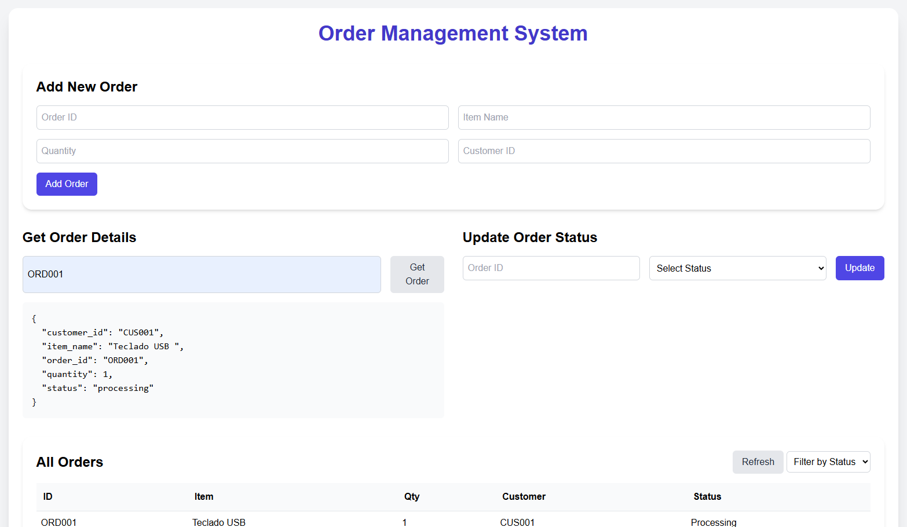

# Udatracker with Test-Driven Development (TDD)

Welcome to the Udatracker project! This guide will walk you through implementing the backend logic and API for your project using a strict **Test-Driven Development (TDD)** workflow.

Your goal is to use the provided test suites to drive your implementation. You'll follow the classic **Red → Green → Refactor** cycle: run a test to see it fail, write the code to make it pass, and then move on to the next feature.



---

## Part 1: Environment Setup

To run this project, follow above:

1.  Navigate to the `backend` directory within the `starter` directory
2.  Activate your virtual environment (`source venv/bin/activate` for macOS/Linux, `.\venv\Scripts\Activate.ps1` for Windows)
   - For the remaining examples, we will use macOS/Linux style paths, e.g. `starter/backend` rather than `starter\backend`. If you are using Windows, you will need to replace `/` with `\` in these commands.
3.  Install dependencies from `requirements.txt` using `pip` (`pip install -r requirements.txt`)

To ensure that the dependencies have been installed, run the Flask server (from the `starter` directory, one level above the `backend` directory):

```bash
python -m backend.app
```

Then check that the application is running:

- If you are working in the Udacity Workspace, select the "Flask App" option from the Links menu to open the app in a new tab
- If you are working locally, open a new tab of your web browser and go to `http://127.0.0.1:5000/`
- In either setting, you can type control-C to stop the server. The server also may stop on its own as you edit the source code. To restart, run `python app.py` again

You will see that there are some parts of the application that produce errors. Your task in this project is to complete the backend code and eliminate those errors. Let's get started!

---

## Part 2: Run the Full Application

Now for the final reward. Let's see your application in action!

1.  **Run the Flask Server**:

    ```bash
    python -m backend.app
    ```

2.  **Open in Browser**:

   - If you are working in the Udacity Workspace, select the "Flask App" option from the Links menu to open the app in a new tab
   - If you are working locally, open a new tab of your web browser and go to `http://127.0.0.1:5000/`

3. **Interact with the App**:

   When you have the application open in your browser, you should see a simple frontend interface. From here you can:

    - Add an order using the form
    - View a list of all orders to confirm that your form inputs are being saved
      - *Note:* we are using in-memory storage, so this list of orders will not persist between sessions
    - Update an order's status (for example, changing it from "pending" to "shipped")
    - Filter orders by status to check that your query routes work correctly

    If everything is implemented correctly, each of these actions should succeed without errors and reflect the current state of your `OrderTracker` logic.
